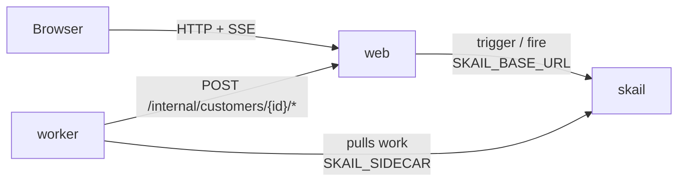

# skail subscription cycle (.NET 8)

[Português (Brasil)](README.pt-BR.md)

A skail function runs the whole life of a subscription. The customer starts a trial, and the function waits for the trial deadline or for the customer to subscribe, whichever comes first. After the subscription it charges the plan once a month: a declined charge gets one retry, and a second decline suspends the subscription. A cancellation stops the charges, and after 12 months the cycle ends. The trial and the month last a few seconds in this demo; a real subscription uses 30 days and one month with the same code. A web page starts the customer, has **Subscribe** and **Cancel subscription** buttons and shows each charge as it happens.

The demo covers three topics of the [skail docs](https://docs.skail.dev) (in Portuguese):

- [recurring billing](https://docs.skail.dev/construa/casos-de-uso/cobranca-recorrencia-e-split-de-pagamento): a subscription is a loop that charges and waits for the next month;
- the [wait with a deadline](https://docs.skail.dev/construa/como-fazer/esperar-um-evento-com-prazo) pattern: the trial ends at the deadline or when the customer subscribes, whichever comes first;
- [hibernation and resume](https://docs.skail.dev/construa/conceitos/hibernacao-e-retomada): between charges the run holds no thread or process, however long the month.

## How it works



- **worker** (`src/SkailSubscriptionCycle.Worker`): the function `ManageSubscription(customerId, trialSeconds, monthSeconds)` in `SubscriptionFunctions.cs` and its commands in `SubscriptionCommands.cs`. `ChargeMonthlyFee` charges one month; `StartTrial`, `StartSubscription` and `NotifyPaymentDeclined` tell the page what happened; `EndTrial`, `SuspendSubscription`, `CancelSubscription` and `EndCycle` end the cycle; `ReportStatus` tells the page when the run fails. The commands delegate to `SubscriptionOperations`, so their logic is tested without skail.
- **web** (`src/SkailSubscriptionCycle.Web`): static page, API and the simulated card network. It starts the run (trigger), records the subscription and the cancellation and sends them to the run (fire), answers each charge by the card chosen on the page, keeps the state in memory and streams it to the page (SSE).
- **contracts** (`src/SkailSubscriptionCycle.Contracts`): types and constants used by the worker and the web app.

In your system, the card network would be your payment gateway. Here it lives in the web app, and the worker reaches it over HTTP.

The function only orchestrates and leaves the I/O to the commands. It creates one wait for `SUBSCRIPTION_CANCELLED` before the loop and reuses it every month. `WhenAny` returns the task that finished first, and the function compares it with the wait. Simplified from [`SubscriptionFunctions.cs`](src/SkailSubscriptionCycle.Worker/SubscriptionFunctions.cs):

```csharp
await commands.StartTrial(customerId);
var subscription = SkailTask.WaitForEvent<Subscription>(Events.CustomerSubscribed, customerId);
if (await SkailTask.WhenAny(SkailTask.DelaySeconds((ulong)trialSeconds), subscription) != subscription)
    return await commands.EndTrial(customerId);

var plan = (await subscription).Plan;
await commands.StartSubscription(customerId, plan);
var cancellation = SkailTask.WaitForEvent<Cancellation>(Events.SubscriptionCancelled, customerId);

for (var month = 1; month <= CycleLimits.MaxMonths; month++)
{
    var charge = await commands.ChargeMonthlyFee(customerId, plan, month, 1);
    if (!charge.Approved)
    {
        await commands.NotifyPaymentDeclined(customerId, month, charge.Reason ?? "");
        await SkailTask.DelaySeconds(CycleLimits.RetrySeconds);
        charge = await commands.ChargeMonthlyFee(customerId, plan, month, 2);
    }
    if (!charge.Approved)
        return await commands.SuspendSubscription(customerId, plan, month, charge.Reason ?? "");

    if (await SkailTask.WhenAny(cancellation, SkailTask.DelaySeconds((ulong)monthSeconds)) == cancellation)
        return await commands.CancelSubscription(customerId, plan, month);
}

return await commands.EndCycle(customerId, plan, CycleLimits.MaxMonths);
```

The function decides by the task that `WhenAny` returned, not by `subscription.IsCompleted`: on a resume, `IsCompleted` already sees a subscription that arrived after the deadline.

A declined card is a result, not an error, because another attempt in the same second would get the same answer. A web app that does not answer throws, and skail runs the command again (`retryCount: 3`). `ChargeMonthlyFee` takes the month and the attempt, and the card network records each pair once, so a retry of the command does not charge twice.

## The paths

The form has the customer name, the plan, the trial and month durations in seconds (20 and 10 by default) and a simulated card. **Start trial** starts a run. **Subscribe** works during the trial, and **Cancel subscription** after the subscription.

| What you do | What happens | Result |
|---|---|---|
| nothing during the trial | the trial ends at the deadline and nothing is charged | **Ended** |
| **Subscribe** with the `approved` card | one charge per month, up to month 12 | **Expired**, 12 months paid |
| **Subscribe**, then **Cancel subscription** | the charges stop, and the months already paid stay paid | **Cancelled** |
| **Subscribe** with the `declined once` card | every month the first attempt is declined, the customer is warned and the retry 5 seconds later is approved | the cycle goes on |
| **Subscribe** with the `always declined` card | month 1 is declined twice | **Suspended** |

A second subscription or cancellation, a subscription after the trial or a cancellation without a subscription gets `409`. The first one wins, and no second event is sent. The countdown on the page is only visual: the real deadline is the durable delay in skail.

## How it connects to skail

| Service | Variable | Used for |
|---|---|---|
| worker | `SKAIL_SIDECAR` | Connects the function to your environment and receives its work. |
| web | `SKAIL_BASE_URL` | Starts runs and sends the subscriptions and cancellations through the skail HTTP API. |

Both use the same `SKAIL_WORKLOAD`, `SKAIL_NAMESPACE` and `SKAIL_KEY`. The web app makes three calls:

```http
POST {SKAIL_BASE_URL}/api/v1/trigger/{name}/{version}/ManageSubscription/{customerId}
["{customerId}", 20, 10]

POST {SKAIL_BASE_URL}/api/v1/fire/CUSTOMER_SUBSCRIBED/{customerId}
{"Plan": "pro", "At": "2026-11-04T10:00:00+00:00"}

POST {SKAIL_BASE_URL}/api/v1/fire/SUBSCRIPTION_CANCELLED/{customerId}
{"Reason": null, "At": "2026-11-04T10:01:30+00:00"}
```

`{name}` and `{version}` come from `SKAIL_WORKLOAD` (`name:version`). The fire bodies use the property names as C# declares them. Each call sends the key in `skail-key` and in `Authorization: Bearer`, plus the `Skail-namespace` header, as described in [authentication](https://docs.skail.dev/referencia/api-http/autenticacao). `429`, `5xx` and network errors are retried with the same customer id. `401` and `403` are not retried: check `SKAIL_KEY` and `SKAIL_NAMESPACE`.

The customer id is a new GUID per customer. It is the run id and the instance id of both events, so another customer never takes these events. The two numbers in the trigger are the trial and month durations, in seconds. They are arguments of the function, so they go into the run history and stay fixed for that run.

The function gets only the id and the durations. The name and the card stay in the web app, so neither one enters the run history or the Monitor; the plan enters with the subscription event.

The browser never calls skail. It only talks to the web app, so the key stays on the server.

## Requirements

- .NET 8 SDK
- podman or docker
- PowerShell 7+ (`pwsh`), only if you use `scripts/run.ps1` instead of `scripts/run.sh`
- A skail environment with the workload from `SKAIL_WORKLOAD` registered (`subscriptioncycle:v1.0.0` by default). The [Quickstart](https://docs.skail.dev/comece-aqui/quickstart) shows how to get an account, create the environment and register the workload.
- A current browser (Chrome/Edge 111+, Firefox 113+, Safari 16.2+). The page uses Server-Sent Events, CSS `color-mix()` and modern JavaScript.

## Configure

```bash
cp .env.example .env     # .env holds the key and is ignored by git
```

Fill in `SKAIL_WORKLOAD` (exactly as registered in the portal), `SKAIL_NAMESPACE`, `SKAIL_KEY`, `SKAIL_SIDECAR` and `SKAIL_BASE_URL` with the values of your environment.

`DEFAULT_TRIAL_SECONDS` and `DEFAULT_MONTH_SECONDS` are the defaults of the form and belong to the web app, so changing them only needs a restart of the web app.

## Run with podman or docker

```bash
scripts/run.sh up        # builds both images and starts web + worker
scripts/run.sh logs
scripts/run.sh down
```

`CONTAINER_ENGINE=docker` forces docker. On Windows, or anywhere with PowerShell 7+, run `pwsh scripts/run.ps1 <command>` with the same commands; `$env:CONTAINER_ENGINE = "docker"` forces docker.

Open <http://localhost:8080> and press **Start trial**.

### See the durability

1. Press **Start trial** with the `approved` card, then **Subscribe**, and wait for `Month 1: charged` on the timeline.
2. Run `scripts/run.sh kill-worker`. It kills the worker with SIGKILL, like a crash; the web app keeps the page state.
3. Wait more than a month (10 seconds by default) with the worker down, then run `scripts/run.sh start-worker`.
4. The month that was due is charged when the worker comes back, and month 1 is not charged again.

In the portal, open the [Monitor](https://docs.skail.dev/referencia/portal/monitor) of your environment and search for the customer id. The run lists `StartTrial`, the trial `WhenAny` with its `Delay` and the `WaitForEvent` for `CUSTOMER_SUBSCRIBED`, then `StartSubscription` and, for each month, `ChargeMonthlyFee` and a `WhenAny` with the `Delay` of the month. The `WaitForEvent` for `SUBSCRIPTION_CANCELLED` shows up once, inside the first monthly `WhenAny`, because the function creates that wait once and reuses it. The log lines of the commands show up between the steps, such as `Month 1, attempt 1 of customer …: approved`. The trial `Delay` shows its full duration even when the customer subscribes earlier; the function moved on as soon as the subscription arrived. In a run with 2-second months, **E2E Duration** was 32.8 s and **Duration** was 2.3 s, because the waits do not use the worker. Every path ends as **Completed**, because the function returns normally; its result says how the cycle ended (`end: "Cancelled"`, for example).

## VS Code

Open the folder and accept the recommended extensions (C# Dev Kit).

- `Ctrl+Shift+B` builds, the *test* task runs the tests and the `containers: up/down/logs/kill-worker/start-worker` tasks call `scripts/run.sh`.
- The **Worker + Web** debug configuration starts both projects reading `.env`, and a breakpoint inside a command works. Outside containers, the worker reaches the web app on `localhost` (`WEB_BASE_URL`, set in `launch.json`).

## Tests

```bash
dotnet test
```

The unit tests cover the contracts, the operations behind the commands, the customer store and the simulated card network, the calls to skail (trigger, fire and retries) and the web API with SSE. They need neither network nor skail. The function itself runs against skail: the paths above and the durability steps are how to check it.

## Notes

- The cancellation is taken between charges. One that arrives while a declined charge waits for the retry is taken after the retry: if the retry is approved, the subscription ends as **Cancelled** with that month paid; if it is declined, it ends as **Suspended**.
- After **Ended**, **Suspended** or **Expired** the waits stay without an answer on purpose, and the web app refuses late clicks with `409`. An event sent straight to the skail API does not pass through that check.
- The customers, their cards and the page history live in the memory of the web app. Restarting it loses them; a run whose customer the web app no longer knows fails at the next charge.
- The cycle stops after 12 months, so the demo does not charge forever. Each month adds steps to the run history; for a subscription that lasts years, the [recurring billing](https://docs.skail.dev/construa/casos-de-uso/cobranca-recorrencia-e-split-de-pagamento) page shows how to end the run each cycle and start the next one.
- There is no real payment gateway, proration, plan change or refund.
- The `/internal/*` routes, which the worker calls, have no authentication. That is fine for a local demo; protect them before using the pattern in production.
- Workers with the same `SKAIL_WORKLOAD` on the same environment share the same runs: use one workload (or environment) per person.

## License

[Apache-2.0](LICENSE)
