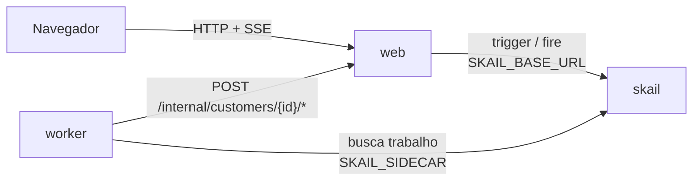

# skail subscription cycle (.NET 8)

[English](README.md)

Uma function do skail cuida da vida inteira de uma assinatura. O cliente começa um trial, e a function espera o fim do prazo do trial ou a assinatura do cliente, o que vier primeiro. Depois da assinatura, ela cobra o plano uma vez por mês: uma cobrança recusada ganha uma nova tentativa, e uma segunda recusa suspende a assinatura. Um cancelamento para as cobranças, e depois de 12 meses o ciclo termina. O trial e o mês duram alguns segundos nesta demo; uma assinatura de verdade usa 30 dias e um mês com o mesmo código. Uma página web cadastra o cliente, tem os botões **Subscribe** e **Cancel subscription** e mostra cada cobrança assim que ela acontece.

A demo mostra três tópicos da [documentação do skail](https://docs.skail.dev):

- [cobrança recorrente](https://docs.skail.dev/construa/casos-de-uso/cobranca-recorrencia-e-split-de-pagamento): uma assinatura é um laço que cobra e espera o próximo mês;
- o padrão de [espera com prazo](https://docs.skail.dev/construa/como-fazer/esperar-um-evento-com-prazo): o trial termina no prazo ou quando o cliente assina, o que vier primeiro;
- [hibernação e retomada](https://docs.skail.dev/construa/conceitos/hibernacao-e-retomada): entre uma cobrança e outra a execução não segura thread nem processo, por mais longo que seja o mês.

## Como funciona



- **worker** (`src/SkailSubscriptionCycle.Worker`): a function `ManageSubscription(customerId, trialSeconds, monthSeconds)` no `SubscriptionFunctions.cs` e os commands dela no `SubscriptionCommands.cs`. O `ChargeMonthlyFee` cobra um mês; `StartTrial`, `StartSubscription` e `NotifyPaymentDeclined` avisam a página do que aconteceu; `EndTrial`, `SuspendSubscription`, `CancelSubscription` e `EndCycle` encerram o ciclo; o `ReportStatus` avisa a página quando a execução falha. Os commands delegam para o `SubscriptionOperations`, então a lógica deles é testada sem o skail.
- **web** (`src/SkailSubscriptionCycle.Web`): página estática, API e a rede de cartões simulada. Inicia a execução (trigger), registra a assinatura e o cancelamento e manda os dois para a execução (fire), responde cada cobrança pelo cartão escolhido na página, guarda o estado em memória e transmite para a página (SSE).
- **contracts** (`src/SkailSubscriptionCycle.Contracts`): tipos e constantes usados pelo worker e pelo web.

No seu sistema, a rede de cartões seria o seu gateway de pagamento. Aqui ela fica no web, e o worker chega nela por HTTP.

A function só orquestra e deixa o I/O para os commands. Ela cria uma única espera por `SUBSCRIPTION_CANCELLED` antes do laço e reaproveita essa espera todo mês. O `WhenAny` devolve a task que terminou primeiro, e a function compara essa task com a espera. O trecho abaixo é uma versão simplificada do [`SubscriptionFunctions.cs`](src/SkailSubscriptionCycle.Worker/SubscriptionFunctions.cs):

```csharp
await commands.StartTrial(customerId);
var subscription = SkailTask.WaitForEvent<Subscription>(Events.CustomerSubscribed, customerId);
if (await SkailTask.WhenAny(SkailTask.DelaySeconds((ulong)trialSeconds), subscription) != subscription)
    return await commands.EndTrial(customerId);

var plan = (await subscription).Plan;
await commands.StartSubscription(customerId, plan);
var cancellation = SkailTask.WaitForEvent<Cancellation>(Events.SubscriptionCancelled, customerId);

for (var month = 1; month <= CycleLimits.MaxMonths; month++)
{
    var charge = await commands.ChargeMonthlyFee(customerId, plan, month, 1);
    if (!charge.Approved)
    {
        await commands.NotifyPaymentDeclined(customerId, month, charge.Reason ?? "");
        await SkailTask.DelaySeconds(CycleLimits.RetrySeconds);
        charge = await commands.ChargeMonthlyFee(customerId, plan, month, 2);
    }
    if (!charge.Approved)
        return await commands.SuspendSubscription(customerId, plan, month, charge.Reason ?? "");

    if (await SkailTask.WhenAny(cancellation, SkailTask.DelaySeconds((ulong)monthSeconds)) == cancellation)
        return await commands.CancelSubscription(customerId, plan, month);
}

return await commands.EndCycle(customerId, plan, CycleLimits.MaxMonths);
```

A function decide pela task que o `WhenAny` devolveu, não por `subscription.IsCompleted`: numa retomada, o `IsCompleted` já enxerga uma assinatura que chegou depois do prazo.

Um cartão recusado é resultado, não erro, porque outra tentativa no mesmo segundo teria a mesma resposta. Um web que não responde lança exceção, e o skail roda o command de novo (`retryCount: 3`). O `ChargeMonthlyFee` recebe o mês e a tentativa, e a rede de cartões registra cada par uma vez só, então uma nova tentativa do command não cobra duas vezes.

## Os caminhos

O formulário tem o nome do cliente, o plano, a duração do trial e do mês em segundos (20 e 10 por padrão) e um cartão simulado. O **Start trial** inicia uma execução. O **Subscribe** funciona durante o trial, e o **Cancel subscription** depois da assinatura.

| O que você faz | O que acontece | Resultado |
|---|---|---|
| nada durante o trial | o trial termina no prazo e nada é cobrado | **Ended** |
| **Subscribe** com o cartão `approved` | uma cobrança por mês, até o mês 12 | **Expired**, 12 meses pagos |
| **Subscribe** e depois **Cancel subscription** | as cobranças param, e os meses já pagos continuam pagos | **Cancelled** |
| **Subscribe** com o cartão `declined once` | todo mês a primeira tentativa é recusada, o cliente é avisado e a nova tentativa, 5 segundos depois, é aprovada | o ciclo continua |
| **Subscribe** com o cartão `always declined` | o mês 1 é recusado duas vezes | **Suspended** |

Uma segunda assinatura ou cancelamento, uma assinatura depois do trial ou um cancelamento sem assinatura recebem `409`. O primeiro vale, e nenhum segundo evento é enviado. A contagem regressiva na página é só visual: o prazo de verdade é o delay durável no skail.

## Como conecta ao skail

| Serviço | Variável | Para quê |
|---|---|---|
| worker | `SKAIL_SIDECAR` | Conecta a function ao seu environment e recebe o trabalho dela. |
| web | `SKAIL_BASE_URL` | Inicia execuções e envia as assinaturas e os cancelamentos pela API HTTP do skail. |

Os dois usam os mesmos `SKAIL_WORKLOAD`, `SKAIL_NAMESPACE` e `SKAIL_KEY`. O web faz três chamadas:

```http
POST {SKAIL_BASE_URL}/api/v1/trigger/{nome}/{versao}/ManageSubscription/{customerId}
["{customerId}", 20, 10]

POST {SKAIL_BASE_URL}/api/v1/fire/CUSTOMER_SUBSCRIBED/{customerId}
{"Plan": "pro", "At": "2026-11-04T10:00:00+00:00"}

POST {SKAIL_BASE_URL}/api/v1/fire/SUBSCRIPTION_CANCELLED/{customerId}
{"Reason": null, "At": "2026-11-04T10:01:30+00:00"}
```

`{nome}` e `{versao}` vêm de `SKAIL_WORKLOAD` (`nome:versao`). Os bodies dos fires usam os nomes das propriedades como o C# declara. Cada chamada manda a chave em `skail-key` e em `Authorization: Bearer`, mais o header `Skail-namespace`, como descrito em [autenticação](https://docs.skail.dev/referencia/api-http/autenticacao). `429`, `5xx` e erros de rede são repetidos com o mesmo id do cliente. `401` e `403` não são repetidos: confira `SKAIL_KEY` e `SKAIL_NAMESPACE`.

O id do cliente é um GUID novo por cliente. Ele é o id da execução e o id da instância dos dois eventos, então outro cliente nunca recebe esses eventos. Os dois números do trigger são a duração do trial e a do mês, em segundos. Eles são argumentos da function, então entram no histórico da execução e ficam fixos para aquela execução.

A function recebe só o id e as durações. O nome e o cartão ficam no web, então nenhum dos dois entra no histórico da execução nem no Monitor; o plano entra com o evento de assinatura.

O navegador nunca chama o skail. Ele só fala com o web, então a chave fica no servidor.

## Requisitos

- SDK do .NET 8
- podman ou docker
- PowerShell 7+ (`pwsh`), só se você usar o `scripts/run.ps1` em vez do `scripts/run.sh`
- Um environment do skail com o workload de `SKAIL_WORKLOAD` cadastrado (`subscriptioncycle:v1.0.0` por padrão). O [Quickstart](https://docs.skail.dev/comece-aqui/quickstart) mostra como pedir a conta, criar o environment e cadastrar o workload.
- Um navegador atual (Chrome/Edge 111+, Firefox 113+, Safari 16.2+). A página usa Server-Sent Events, `color-mix()` do CSS e JavaScript moderno.

## Configurar

```bash
cp .env.example .env     # o .env guarda a chave e é ignorado pelo git
```

Preencha `SKAIL_WORKLOAD` (exatamente como está cadastrado no portal), `SKAIL_NAMESPACE`, `SKAIL_KEY`, `SKAIL_SIDECAR` e `SKAIL_BASE_URL` com os valores do seu environment.

`DEFAULT_TRIAL_SECONDS` e `DEFAULT_MONTH_SECONDS` são os valores iniciais do formulário e são do web, então mudar esses valores só pede um reinício do web.

## Rodar com podman ou docker

```bash
scripts/run.sh up        # builda as duas imagens e sobe web + worker
scripts/run.sh logs
scripts/run.sh down
```

`CONTAINER_ENGINE=docker` força o docker. No Windows, ou em qualquer sistema com PowerShell 7+, rode `pwsh scripts/run.ps1 <comando>` com os mesmos comandos; `$env:CONTAINER_ENGINE = "docker"` força o docker.

Abra <http://localhost:8080> e clique em **Start trial**.

### Ver a durabilidade

1. Clique em **Start trial** com o cartão `approved`, depois em **Subscribe**, e espere aparecer `Month 1: charged` na timeline.
2. Rode `scripts/run.sh kill-worker`. Ele mata o worker com SIGKILL, como numa queda, e o web mantém o estado da página.
3. Espere mais de um mês (10 segundos por padrão) com o worker parado e rode `scripts/run.sh start-worker`.
4. O mês que venceu é cobrado quando o worker volta, e o mês 1 não é cobrado de novo.

No portal, abra o [Monitor](https://docs.skail.dev/referencia/portal/monitor) do seu environment e procure pelo id do cliente. A execução lista o `StartTrial`, o `WhenAny` do trial com o seu `Delay` e o `WaitForEvent` do `CUSTOMER_SUBSCRIBED`, depois o `StartSubscription` e, para cada mês, o `ChargeMonthlyFee` e um `WhenAny` com o `Delay` do mês. O `WaitForEvent` do `SUBSCRIPTION_CANCELLED` aparece uma vez só, dentro do primeiro `WhenAny` mensal, porque a function cria essa espera uma vez e reaproveita. As linhas de log dos commands aparecem entre os passos, como `Month 1, attempt 1 of customer …: approved`. O `Delay` do trial aparece com a duração inteira mesmo quando o cliente assina antes; a function seguiu em frente assim que a assinatura chegou. Numa execução com meses de 2 segundos, o **E2E Duration** foi de 32,8 s e o **Duration** de 2,3 s, porque as esperas não ocupam o worker. Todo caminho termina como **Completed**, porque a function retorna normalmente; o resultado dela diz como o ciclo terminou (`end: "Cancelled"`, por exemplo).

## VS Code

Abra a pasta e aceite as extensões recomendadas (C# Dev Kit).

- `Ctrl+Shift+B` compila, a task *test* roda os testes e as tasks `containers: up/down/logs/kill-worker/start-worker` chamam o `scripts/run.sh`.
- A configuração de debug **Worker + Web** sobe os dois projetos lendo o `.env`, e um breakpoint dentro de um command funciona. Fora de container, o worker acessa o web em `localhost` (`WEB_BASE_URL`, definido no `launch.json`).

## Testes

```bash
dotnet test
```

Os testes unitários cobrem os contratos, as operações por trás dos commands, o estado dos clientes e a rede de cartões simulada, as chamadas ao skail (trigger, fire e novas tentativas) e a API web com SSE. Eles não precisam de rede nem do skail. A function em si roda contra o skail: os caminhos acima e os passos de durabilidade são a forma de conferir.

## Observações

- O cancelamento é recebido entre uma cobrança e outra. Um cancelamento que chega enquanto uma cobrança recusada espera a nova tentativa é recebido depois dela: se a nova tentativa for aprovada, a assinatura termina como **Cancelled** com aquele mês pago; se for recusada, termina como **Suspended**.
- Depois de **Ended**, **Suspended** ou **Expired**, as esperas ficam sem resposta de propósito, e o web recusa cliques atrasados com `409`. Um evento enviado direto para a API do skail não passa por essa verificação.
- Os clientes, os cartões deles e o histórico da página ficam na memória do web. Reiniciar o web perde tudo isso; uma execução cujo cliente o web não conhece mais falha na próxima cobrança.
- O ciclo para depois de 12 meses, para a demo não cobrar para sempre. Cada mês acrescenta passos ao histórico da execução; para uma assinatura que dura anos, a página de [cobrança recorrente](https://docs.skail.dev/construa/casos-de-uso/cobranca-recorrencia-e-split-de-pagamento) mostra como encerrar a execução a cada ciclo e iniciar a próxima.
- Não há gateway de pagamento de verdade, cobrança proporcional, troca de plano nem estorno.
- As rotas `/internal/*`, que o worker chama, não têm autenticação. Para uma demo local isso basta; proteja essas rotas antes de usar o padrão em produção.
- Workers com o mesmo `SKAIL_WORKLOAD` no mesmo environment dividem as mesmas execuções: use um workload (ou environment) por pessoa.

## Licença

[Apache-2.0](LICENSE)
